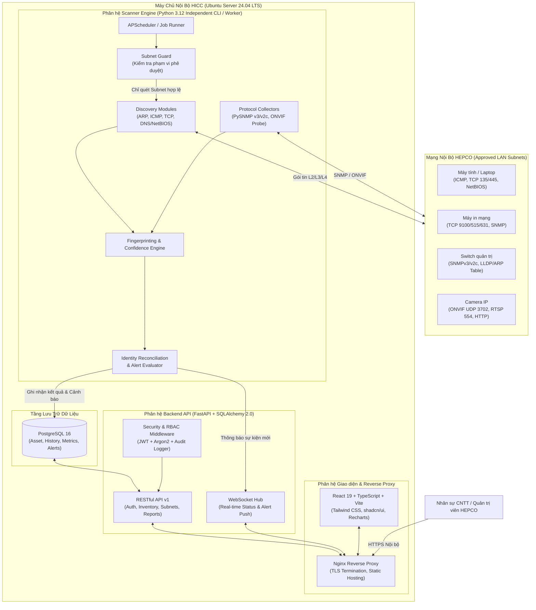
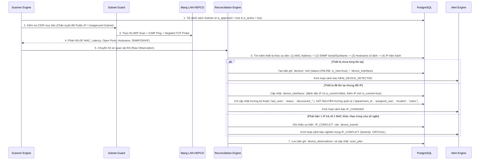

# 02. KIẾN TRÚC HỆ THỐNG (SYSTEM ARCHITECTURE)

Tài liệu này mô tả chi tiết kiến trúc tổng thể, sự phân tách giữa các phân hệ, luồng dữ liệu thời gian thực và cơ chế đối soát định danh thiết bị của hệ thống **HEPCO IT COMMAND CENTER (HICC V1.0)**.

---

## 1. Sơ đồ Kiến trúc Tổng thể (High-Level Architecture)

Hệ thống HICC V1.0 được thiết kế theo kiến trúc **Modular Monolith kết hợp Standalone Worker Engine**, đóng gói và vận hành hoàn toàn trên hạ tầng máy chủ nội bộ (On-Premise Server) của HEPCO.

---

## 2. Chi tiết Các Phân hệ Kỹ thuật

### 2.1. Phân hệ Scanner Engine (`scanner/`)
- **Đặc tính cốt lõi:** Hoạt động hoàn toàn độc lập với Frontend và có thể thực thi trực tiếp qua giao diện dòng lệnh (`python -m hicc_scanner.cli ...`) hoặc chạy nền theo lịch trình (`APScheduler`).
- **Tách biệt tiến trình:** Scanner Engine kết nối trực tiếp vào PostgreSQL thông qua tầng Repository chuẩn hóa và gửi thông báo sự kiện sang Backend qua kênh `PostgreSQL LISTEN/NOTIFY` hoặc Internal Webhook. Nhờ đó, ngay cả khi Web Server bảo trì, tiến trình giám sát mạng và ghi nhận lịch sử vẫn không bị gián đoạn.
- **Quyền hạn hệ điều hành:** Container hoặc dịch vụ chạy Scanner được cấp quyền tối thiểu `CAP_NET_RAW` và `CAP_NET_ADMIN` trên Linux để gửi gói tin ARP/ICMP thô mà không cần chạy toàn bộ hệ thống dưới quyền `root` không kiểm soát.

### 2.2. Phân hệ Cơ sở dữ liệu (`database/` – PostgreSQL 16)
- Sử dụng các kiểu dữ liệu chuyên biệt cho hạ tầng mạng của PostgreSQL như `INET` (địa chỉ IP), `CIDR` (dải mạng Subnet), `MACADDR` (địa chỉ vật lý MAC) và `JSONB` (lưu trữ linh hoạt danh sách cổng mở, thông số mở rộng SNMP/ONVIF).
- Quản lý phiên bản lược đồ (Schema Versioning) chặt chẽ bằng **Alembic**.

### 2.3. Phân hệ Backend API (`backend/` – FastAPI)
- Cung cấp các API bất đồng bộ (`async/await`) hiệu năng cao với thời gian phản hồi mục tiêu dưới 200ms cho các truy vấn thông thường và dưới 2 giây cho các truy vấn tổng hợp Dashboard.
- Tích hợp **Pydantic v2** để kiểm tra kiểu dữ liệu đầu vào/đầu ra nghiêm ngặt.
- Cung cấp **WebSocket Endpoint (`/api/v1/ws/events`)** giúp đẩy trạng thái thiết bị vừa Online/Offline hoặc cảnh báo khẩn cấp lên màn hình điều hành ngay khi phát hiện.

### 2.4. Phân hệ Frontend Dashboard (`frontend/` – React + TypeScript)
- Thiết kế theo chuẩn **Desktop-First Dark Mode** mang màu sắc nhận diện thương hiệu HEPCO (Xanh môi trường kết hợp Cyan kỹ thuật).
- Chỉ kết nối dữ liệu thực từ REST API và WebSocket; không chứa bất kỳ mảng dữ liệu mẫu cố định nào trong mã nguồn giao diện.

---

## 3. Luồng Xử lý Dữ liệu và Đối soát Định danh (Data & Identity Flow)

Một trong những bài toán kiến trúc quan trọng nhất của HICC V1.0 là: **Làm sao nhận diện đúng một thiết bị khi IP thay đổi, và làm sao không ghi đè dữ liệu do nhân viên CNTT đã nhập?**

---

## 4. Cơ chế Tách biệt Dữ liệu Tự động và Dữ liệu Quản trị (Two-Plane Data Model)

Để đảm bảo nguyên tắc **"Lần quét tiếp theo không được ghi đè trường quản lý thủ công"**, bảng `devices` và logic cập nhật được thiết kế chia làm 2 mặt phẳng dữ liệu rõ rệt:

| Nhóm trường dữ liệu | Các cột tiêu biểu trong Database | Quyền ghi của Scanner Engine | Quyền ghi của Nhân viên CNTT |
| :--- | :--- | :--- | :--- |
| **Mặt phẳng Khám phá Tự động (Discovery Plane)** | `discovered_hostname`, `discovered_os`, `manufacturer`, `discovered_model`, `device_type_confidence`, `status`, `first_seen`, `last_seen`, `consecutive_failures` | **Có** (Cập nhật tự động mỗi chu kỳ quét) | Chỉ xem (Hoặc xác nhận chuyển thành dữ liệu chuẩn) |
| **Mặt phẳng Quản trị Tài sản (Management Plane)** | `device_code` (Mã TS), `display_name`, `department_id`, `assigned_user`, `location`, `notes`, `is_type_locked`, `is_authorized` | **KHÔNG** (Tuyệt đối không chạm tới khi thiết bị đã tồn tại) | **Có** (Cập nhật qua giao diện Inventory) |

> [!IMPORTANT]
> Khi cờ `is_type_locked = TRUE` (nhân viên CNTT đã xác nhận thủ công loại thiết bị là Máy in, Switch, Camera hoặc Máy tính), bộ phân loại tự động (Fingerprinting Engine) sẽ vẫn tính toán kết quả trong log quét nhưng **không tự động thay đổi** `device_type_id` của thiết bị đó nữa.

---

## 5. Chiến lược Mở rộng (Scalability: 150 -> 1.000 Thiết bị)

- **Từ 100 – 150 thiết bị (Quy mô ban đầu):** Một tiến trình Scanner Worker bất đồng bộ (`asyncio` + `scapy`/`nmap` worker pool) quét một dải `/24` hoàn tất trong khoảng 20–45 giây với mức tiêu thụ tài nguyên rất thấp (< 1 vCPU, < 512MB RAM).
- **Mở rộng lên 500 – 1.000 thiết bị (Nhiều VLAN / Subnet):**
  - Thiết kế bảng `network_subnets` cho phép cấu hình chu kỳ quét riêng cho từng VLAN (ví dụ: VLAN Server/Switch quét mỗi 30 giây; VLAN Máy trạm văn phòng quét mỗi 60 giây).
  - Các bảng lịch sử lớn (`device_observations`, `snmp_metrics`) được đánh chỉ mục tổ hợp `(device_id, observed_at DESC)` và đi kèm tác vụ dọn dẹp/nén dữ liệu định kỳ (Data Retention Policy), đảm bảo truy vấn Dashboard luôn dưới 2 giây sau nhiều năm vận hành.
