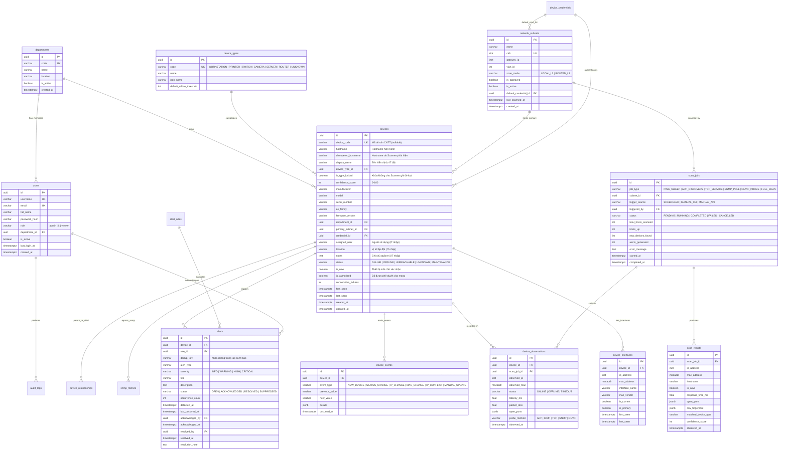

# 03. THIẾT KẾ CƠ SỞ DỮ LIỆU (POSTGRESQL DATABASE DESIGN)

Tài liệu này quy định chi tiết lược đồ cơ sở dữ liệu **PostgreSQL 16+** cho hệ thống **HEPCO IT COMMAND CENTER (HICC V1.0)**, bao gồm sơ đồ thực thể liên kết (ERD), cấu trúc 16 bảng cốt lõi và mở rộng, chiến lược đánh chỉ mục (Indexing), ràng buộc toàn vẹn (Constraints) và chính sách lưu trữ lịch sử (Data Retention).

---

## 1. Nguyên tắc Thiết kế Cơ sở Dữ liệu

1. **Định danh bằng UUID v4 (`UUID`):** Toàn bộ các bảng thực thể nghiệp vụ chính (`devices`, `device_interfaces`, `scan_jobs`, `alerts`, `users`...) sử dụng `UUID` làm khóa chính. **Tuyệt đối không dùng địa chỉ IP làm khóa chính** vì IP có thể biến động theo DHCP hoặc chuyển đổi giữa các thiết bị.
2. **Kiểu dữ liệu Mạng chuẩn PostgreSQL:**
   - Sử dụng `CIDR` cho dải mạng (`network_subnets.cidr`, ví dụ: `10.10.20.0/24`).
   - Sử dụng `INET` cho địa chỉ IP (`ip_address`), hỗ trợ toán tử kiểm tra IP thuộc Subnet (`<<`).
   - Sử dụng `MACADDR` (chuẩn hóa dạng `AA:BB:CC:DD:EE:FF`) cho địa chỉ vật lý.
3. **Chuẩn hóa Thời gian (`TIMESTAMPTZ`):** Mọi cột thời gian đều sử dụng `TIMESTAMP WITH TIME ZONE` (lưu theo UTC và hiển thị theo múi giờ `Asia/Ho_Chi_Minh` `+07:00`).
4. **Không xóa dữ liệu lịch sử khi thiết bị Offline:** Khi thiết bị ngắt kết nối, trạng thái chuyển sang `OFFLINE`, giữ nguyên toàn bộ lịch sử IP, lịch sử quan sát (`device_observations`) và sự kiện (`device_events`).
5. **Tách biệt trường tự động và trường quản trị:** Đảm bảo Scanner không bao giờ ghi đè thông tin do nhân viên CNTT nhập thủ công.

---

## 2. Sơ đồ Thực thể Liên kết (Entity-Relationship Diagram - ERD)



---

## 3. Đặc tả Chi tiết Các Bảng Dữ liệu (16 Bảng)

### 3.1. Nhóm Bảng Quản trị, Tổ chức và Cấu hình Mạng

#### 1) Bảng `departments` (Phòng ban / Đơn vị trực thuộc HEPCO)
Lưu trữ danh mục phòng ban, xí nghiệp, trạm thu phí thuộc HEPCO để gán quyền sở hữu thiết bị.
- `id` (`UUID`, PK, Default `gen_random_uuid()`)
- `code` (`VARCHAR(50)`, UNIQUE, NOT NULL) — Mã phòng ban (VD: `CNTT`, `KT`, `TCHC`, `XN_MT1`).
- `name` (`VARCHAR(150)`, NOT NULL) — Tên phòng ban đầy đủ.
- `location` (`VARCHAR(255)`) — Địa điểm văn phòng / cơ sở.
- `description` (`TEXT`)
- `is_active` (`BOOLEAN`, NOT NULL, Default `TRUE`)
- `created_at`, `updated_at` (`TIMESTAMPTZ`, NOT NULL, Default `NOW()`)

#### 2) Bảng `users` (Người dùng hệ thống HICC)
Quản lý tài khoản đăng nhập và phân quyền RBAC (`admin`, `it`, `viewer`).
- `id` (`UUID`, PK)
- `username` (`VARCHAR(64)`, UNIQUE, NOT NULL)
- `email` (`VARCHAR(150)`, UNIQUE)
- `full_name` (`VARCHAR(150)`, NOT NULL)
- `password_hash` (`VARCHAR(255)`, NOT NULL) — Băm bằng **Argon2id** hoặc **bcrypt**.
- `role` (`VARCHAR(20)`, NOT NULL) — Check Constraint: `role IN ('admin', 'it', 'viewer')`.
- `department_id` (`UUID`, FK -> `departments.id`, ON DELETE SET NULL)
- `is_active` (`BOOLEAN`, NOT NULL, Default `TRUE`)
- `last_login_at` (`TIMESTAMPTZ`)
- `created_at`, `updated_at` (`TIMESTAMPTZ`, NOT NULL)

#### 3) Bảng `device_types` (Danh mục Phân loại Thiết bị)
Định nghĩa các nhóm thiết bị chuẩn hóa trong hệ thống.
- `id` (`UUID`, PK)
- `code` (`VARCHAR(50)`, UNIQUE, NOT NULL) — Các mã chuẩn: `WORKSTATION` (Máy tính/Laptop), `PRINTER` (Máy in mạng), `SWITCH` (Switch mạng), `CAMERA` (Camera IP), `SERVER` (Máy chủ), `ROUTER` (Thiết bị định tuyến/Firewall), `ACCESS_POINT` (Bộ phát Wi-Fi), `UNKNOWN` (Chưa xác định).
- `name` (`VARCHAR(100)`, NOT NULL)
- `icon_name` (`VARCHAR(50)`)
- `default_offline_threshold` (`INTEGER`, NOT NULL, Default `3`) — Số lần quét thất bại liên tiếp trước khi kết luận Offline.
- `description` (`TEXT`)
- `created_at` (`TIMESTAMPTZ`, NOT NULL)

#### 4) Bảng `network_subnets` (Danh mục Dải mạng LAN được Quản lý)
Bảng kiểm soát phạm vi quét an toàn (**Subnet Guard**). Scanner chỉ được phép quét các bản ghi có `is_approved = TRUE` và `is_active = TRUE`.
- `id` (`UUID`, PK)
- `name` (`VARCHAR(150)`, NOT NULL) — Tên gợi nhớ (VD: `LAN Văn phòng Chính - Tầng 2`).
- `cidr` (`CIDR`, UNIQUE, NOT NULL) — Dải mạng chuẩn CIDR (VD: `192.168.10.0/24`).
- `gateway_ip` (`INET`) — Địa chỉ Default Gateway của Subnet.
- `vlan_id` (`INTEGER`) — Check Constraint: `vlan_id BETWEEN 1 AND 4094`.
- `scan_mode` (`VARCHAR(20)`, NOT NULL, Default `'LOCAL_L2'`) — `LOCAL_L2` (cùng Broadcast Domain, quét ARP trực tiếp) hoặc `ROUTED_L3` (khác VLAN, quét qua ICMP/TCP/SNMP).
- `is_approved` (`BOOLEAN`, NOT NULL, Default `FALSE`) — Cờ phê duyệt an toàn bởi Admin.
- `is_active` (`BOOLEAN`, NOT NULL, Default `TRUE`)
- `ping_interval_sec` (`INTEGER`, NOT NULL, Default `60`)
- `discovery_interval_sec` (`INTEGER`, NOT NULL, Default `300`)
- `default_credential_id` (`UUID`, FK -> `device_credentials.id`, ON DELETE SET NULL)
- `description` (`TEXT`)
- `approved_by` (`UUID`, FK -> `users.id`, ON DELETE SET NULL)
- `approved_at` (`TIMESTAMPTZ`)
- `last_scanned_at` (`TIMESTAMPTZ`)
- `created_at`, `updated_at` (`TIMESTAMPTZ`, NOT NULL)

---

### 3.2. Nhóm Bảng Lõi Kiểm kê Thiết bị & Lịch sử Giao diện

#### 5) Bảng `devices` (Hồ sơ Thiết bị CNTT Trung tâm)
Lưu trữ trạng thái hiện hành và thông tin quản lý tài sản của từng thiết bị.
- `id` (`UUID`, PK, Default `gen_random_uuid()`)
- `device_code` (`VARCHAR(64)`, UNIQUE, NULLABLE) — Mã tài sản nội bộ của HEPCO (do IT gán).
- `hostname` (`VARCHAR(255)`) — Hostname chính thức đang hiển thị.
- `discovered_hostname` (`VARCHAR(255)`) — Hostname mới nhất do Scanner thu thập qua DNS/NetBIOS/SNMP.
- `display_name` (`VARCHAR(255)`) — Tên gợi nhớ do nhân viên CNTT đặt (Không bao giờ bị Scanner ghi đè).
- `device_type_id` (`UUID`, FK -> `device_types.id`, NOT NULL)
- `is_type_locked` (`BOOLEAN`, NOT NULL, Default `FALSE`) — Khi `TRUE`, Scanner không tự động đổi `device_type_id`.
- `confidence_score` (`INTEGER`, NOT NULL, Default `0`) — Điểm tin cậy phân loại tự động (`0` đến `100`).
- `manufacturer` (`VARCHAR(150)`) — Hãng sản xuất (HP, Canon, Cisco, Hikvision, Dell...).
- `model` (`VARCHAR(150)`) — Dòng máy / Model thiết bị.
- `serial_number` (`VARCHAR(150)`) — Số Serial phần cứng (thu thập qua SNMP/ONVIF hoặc nhập tay).
- `os_family` (`VARCHAR(100)`) — Hệ điều hành nhận diện được (Windows, Linux, Embedded Printer/Camera...).
- `firmware_version` (`VARCHAR(100)`)
- `department_id` (`UUID`, FK -> `departments.id`, ON DELETE SET NULL) — Trường quản lý thủ công.
- `primary_subnet_id` (`UUID`, FK -> `network_subnets.id`, ON DELETE SET NULL)
- `credential_id` (`UUID`, FK -> `device_credentials.id`, ON DELETE SET NULL)
- `assigned_user` (`VARCHAR(150)`) — Người đang sử dụng thiết bị (Trường quản lý thủ công).
- `location` (`VARCHAR(255)`) — Vị trí lắp đặt vật lý (Trường quản lý thủ công).
- `notes` (`TEXT`) — Ghi chú của bộ phận CNTT (Trường quản lý thủ công).
- `status` (`VARCHAR(20)`, NOT NULL, Default `'UNKNOWN'`) — Check: `status IN ('ONLINE', 'OFFLINE', 'UNREACHABLE', 'UNKNOWN', 'MAINTENANCE')`.
- `is_new` (`BOOLEAN`, NOT NULL, Default `TRUE`) — Đánh dấu thiết bị mới phát hiện chưa được IT rà soát.
- `is_authorized` (`BOOLEAN`, NOT NULL, Default `FALSE`) — Đánh dấu thiết bị hợp lệ trong mạng.
- `icmp_blocked` (`BOOLEAN`, NOT NULL, Default `FALSE`) — Đánh dấu thiết bị chặn Ping nhưng vẫn phản hồi ARP/TCP.
- `consecutive_failures` (`INTEGER`, NOT NULL, Default `0`) — Số chu kỳ liên tiếp không phản hồi.
- `last_ip_address` (`INET`) — Cache IP hiện hành để tăng tốc truy vấn danh sách.
- `last_mac_address` (`MACADDR`) — Cache MAC chính để tăng tốc truy vấn danh sách.
- `custom_metadata` (`JSONB`, Default `'{}'::jsonb`) — Thông tin đặc thù (số trang in, số cổng switch, độ phân giải camera...).
- `first_seen` (`TIMESTAMPTZ`, NOT NULL, Default `NOW()`)
- `last_seen` (`TIMESTAMPTZ`)
- `created_at`, `updated_at` (`TIMESTAMPTZ`, NOT NULL, Default `NOW()`)

#### 6) Bảng `device_interfaces` (Giao diện Mạng & Lịch sử Biến động IP/MAC)
Mỗi khi thiết bị nhận IP mới hoặc thay đổi card mạng, lịch sử được bảo toàn tại bảng này: bản ghi cũ chuyển `is_current = FALSE`, bản ghi mới mang `is_current = TRUE`.
- `id` (`UUID`, PK)
- `device_id` (`UUID`, FK -> `devices.id`, ON DELETE CASCADE, NOT NULL)
- `ip_address` (`INET`, NOT NULL)
- `mac_address` (`MACADDR`, NULLABLE) — Có thể `NULL` nếu quét qua Routed L3 mà chưa lấy được bảng ARP từ Switch.
- `interface_name` (`VARCHAR(100)`, Default `'eth0'`) — Tên cổng mạng (VD: `GigabitEthernet0/1`, `vlan1`).
- `if_index` (`INTEGER`) — Chỉ số cổng SNMP (`ifIndex`).
- `mac_vendor` (`VARCHAR(150)`) — Nhà sản xuất tra cứu từ 24-bit OUI của MAC.
- `is_current` (`BOOLEAN`, NOT NULL, Default `TRUE`) — Cặp IP/MAC đang hoạt động hiện tại.
- `is_primary` (`BOOLEAN`, NOT NULL, Default `TRUE`)
- `first_seen` (`TIMESTAMPTZ`, NOT NULL, Default `NOW()`)
- `last_seen` (`TIMESTAMPTZ`, NOT NULL, Default `NOW()`)

#### 7) Bảng `device_observations` (Lịch sử Quan sát Trạng thái & Độ trễ)
Lưu chuỗi thời gian kết quả kiểm tra kết nối của từng thiết bị qua mỗi chu kỳ quét.
- `id` (`UUID`, PK)
- `device_id` (`UUID`, FK -> `devices.id`, ON DELETE CASCADE, NOT NULL)
- `scan_job_id` (`UUID`, FK -> `scan_jobs.id`, ON DELETE SET NULL)
- `observed_ip` (`INET`, NOT NULL)
- `observed_mac` (`MACADDR`)
- `status` (`VARCHAR(20)`, NOT NULL) — `ONLINE`, `OFFLINE`, `TIMEOUT`, `DEGRADED`.
- `latency_ms` (`REAL`) — Thời gian phản hồi tính bằng mili-giây (`ms`).
- `packet_loss` (`REAL`, Default `0.0`) — Tỷ lệ mất gói (`0.0` đến `100.0`).
- `open_ports` (`JSONB`, Default `'[]'::jsonb`) — Danh sách cổng TCP mở tại thời điểm quan sát (VD: `[80, 443, 9100]`).
- `probe_method` (`VARCHAR(30)`, NOT NULL) — Phương thức xác nhận sống (`ARP`, `ICMP`, `TCP_SYN`, `SNMP`, `ONVIF`).
- `observed_at` (`TIMESTAMPTZ`, NOT NULL, Default `NOW()`)

#### 8) Bảng `device_events` (Nhật ký Vòng đời & Sự kiện Thiết bị)
Ghi lại các mốc biến động quan trọng của thiết bị (thay đổi IP, thay đổi MAC, chuyển trạng thái Online/Offline, nhân viên cập nhật thông tin).
- `id` (`UUID`, PK)
- `device_id` (`UUID`, FK -> `devices.id`, ON DELETE CASCADE, NOT NULL)
- `event_type` (`VARCHAR(50)`, NOT NULL) — `NEW_DEVICE`, `STATE_ONLINE`, `STATE_OFFLINE`, `IP_CHANGED`, `MAC_CHANGED`, `IP_CONFLICT`, `HOSTNAME_CHANGED`, `ASSET_UPDATED`.
- `severity` (`VARCHAR(20)`, NOT NULL, Default `'INFO'`)
- `previous_value` (`VARCHAR(255)`)
- `new_value` (`VARCHAR(255)`)
- `description` (`TEXT`, NOT NULL)
- `details` (`JSONB`, Default `'{}'::jsonb`)
- `occurred_at` (`TIMESTAMPTZ`, NOT NULL, Default `NOW()`)

---

### 3.3. Nhóm Bảng Phiên Quét & Cảnh báo

#### 9) Bảng `scan_jobs` (Quản lý Phiên Quét Mạng)
Lưu lịch sử toàn bộ các lần thực thi của Scanner Engine (tự động hoặc qua CLI/API).
- `id` (`UUID`, PK)
- `job_type` (`VARCHAR(40)`, NOT NULL) — `PING_SWEEP`, `ARP_DISCOVERY`, `HOSTNAME_REFRESH`, `SNMP_POLL`, `ONVIF_PROBE`, `FULL_DISCOVERY`.
- `subnet_id` (`UUID`, FK -> `network_subnets.id`, ON DELETE SET NULL)
- `target_cidr` (`VARCHAR(64)`, NOT NULL)
- `trigger_source` (`VARCHAR(30)`, NOT NULL, Default `'SCHEDULED'`) — `SCHEDULED`, `MANUAL_CLI`, `MANUAL_API`.
- `triggered_by` (`UUID`, FK -> `users.id`, ON DELETE SET NULL)
- `scanner_host` (`VARCHAR(100)`) — Tên máy chủ chạy Scanner.
- `status` (`VARCHAR(20)`, NOT NULL, Default `'PENDING'`) — `PENDING`, `RUNNING`, `COMPLETED`, `FAILED`, `CANCELLED`.
- `total_hosts_scanned` (`INTEGER`, NOT NULL, Default `0`)
- `hosts_up` (`INTEGER`, NOT NULL, Default `0`)
- `hosts_down` (`INTEGER`, NOT NULL, Default `0`)
- `new_devices_found` (`INTEGER`, NOT NULL, Default `0`)
- `alerts_generated` (`INTEGER`, NOT NULL, Default `0`)
- `duration_ms` (`INTEGER`)
- `error_message` (`TEXT`)
- `scan_summary` (`JSONB`, Default `'{}'::jsonb`)
- `started_at` (`TIMESTAMPTZ`, NOT NULL, Default `NOW()`)
- `completed_at` (`TIMESTAMPTZ`)

#### 10) Bảng `scan_results` (Kết quả Thô Từng Phiên Quét)
Lưu dữ liệu chi tiết thu được trên từng IP trong một `scan_job` để phục vụ đối chiếu và kiểm toán kỹ thuật.
- `id` (`UUID`, PK)
- `scan_job_id` (`UUID`, FK -> `scan_jobs.id`, ON DELETE CASCADE, NOT NULL)
- `device_id` (`UUID`, FK -> `devices.id`, ON DELETE SET NULL)
- `ip_address` (`INET`, NOT NULL)
- `mac_address` (`MACADDR`)
- `mac_vendor` (`VARCHAR(150)`)
- `hostname` (`VARCHAR(255)`)
- `is_alive` (`BOOLEAN`, NOT NULL, Default `FALSE`)
- `response_time_ms` (`REAL`)
- `open_ports` (`JSONB`, Default `'[]'::jsonb`)
- `raw_fingerprint` (`JSONB`, Default `'{}'::jsonb`) — Chứa kết quả SNMP sysDescr, ONVIF scopes, NetBIOS name...
- `matched_device_type` (`VARCHAR(50)`)
- `confidence_score` (`INTEGER`, Default `0`)
- `observed_at` (`TIMESTAMPTZ`, NOT NULL, Default `NOW()`)

#### 11) Bảng `alerts` (Quản lý Cảnh báo Vận hành)
Lưu trữ các cảnh báo phát sinh cùng quy trình tiếp nhận/xử lý và cơ chế chống trùng lặp (`dedup_key`).
- `id` (`UUID`, PK)
- `device_id` (`UUID`, FK -> `devices.id`, ON DELETE CASCADE, NULLABLE) — Có thể `NULL` nếu là cảnh báo cấp hệ thống như `SCANNER_FAILED`.
- `subnet_id` (`UUID`, FK -> `network_subnets.id`, ON DELETE SET NULL)
- `rule_id` (`UUID`, FK -> `alert_rules.id`, ON DELETE SET NULL)
- `dedup_key` (`VARCHAR(255)`, NOT NULL) — Khóa định danh duy nhất cho sự cố đang mở (VD: `DEVICE_OFFLINE:uuid-thiet-bi` hoặc `IP_CONFLICT:192.168.1.50`).
- `alert_type` (`VARCHAR(50)`, NOT NULL) — `NEW_DEVICE`, `DEVICE_OFFLINE`, `DEVICE_RECOVERED`, `IP_CHANGED`, `IP_CONFLICT`, `MAC_ANOMALY`, `SNMP_UNREACHABLE`, `CAMERA_UNREACHABLE`, `SCANNER_FAILURE`.
- `severity` (`VARCHAR(20)`, NOT NULL) — `INFO`, `WARNING`, `HIGH`, `CRITICAL`.
- `title` (`VARCHAR(255)`, NOT NULL)
- `description` (`TEXT`, NOT NULL)
- `status` (`VARCHAR(20)`, NOT NULL, Default `'OPEN'`) — `OPEN`, `ACKNOWLEDGED`, `RESOLVED`, `SUPPRESSED`.
- `occurrence_count` (`INTEGER`, NOT NULL, Default `1`) — Tăng lên khi sự cố lặp lại mà không tạo bản ghi rác mới.
- `context_data` (`JSONB`, Default `'{}'::jsonb`)
- `detected_at` (`TIMESTAMPTZ`, NOT NULL, Default `NOW()`)
- `last_occurred_at` (`TIMESTAMPTZ`, NOT NULL, Default `NOW()`)
- `acknowledged_by` (`UUID`, FK -> `users.id`, ON DELETE SET NULL)
- `acknowledged_at` (`TIMESTAMPTZ`)
- `resolved_by` (`UUID`, FK -> `users.id`, ON DELETE SET NULL)
- `resolved_at` (`TIMESTAMPTZ`)
- `resolution_note` (`TEXT`)

#### 12) Bảng `audit_logs` (Nhật ký Kiểm toán Bảo mật)
Lưu vết toàn bộ hành động của người dùng trên hệ thống.
- `id` (`UUID`, PK)
- `user_id` (`UUID`, FK -> `users.id`, ON DELETE SET NULL)
- `username` (`VARCHAR(64)`)
- `action` (`VARCHAR(100)`, NOT NULL) — VD: `SUBNET_APPROVE`, `DEVICE_UPDATE`, `SCAN_TRIGGER`, `ALERT_ACK`, `USER_LOGIN`.
- `target_type` (`VARCHAR(50)`, NOT NULL) — `DEVICE`, `SUBNET`, `ALERT`, `USER`, `SETTING`.
- `target_id` (`VARCHAR(100)`)
- `client_ip` (`INET`)
- `user_agent` (`VARCHAR(255)`)
- `old_values` (`JSONB`)
- `new_values` (`JSONB`)
- `created_at` (`TIMESTAMPTZ`, NOT NULL, Default `NOW()`)

---

### 3.4. Nhóm Bảng Mở rộng Chuyên sâu (Extended Tables)

#### 13) Bảng `device_credentials` (Quản lý Thông tin Xác thực SNMP / ONVIF Mã hóa)
Lưu hồ sơ xác thực để Scanner truy vấn Switch, Máy in và Camera IP. Toàn bộ mật khẩu/khóa đều được mã hóa đối xứng **Fernet (AES-128-CBC + HMAC-SHA256)** bằng `HICC_MASTER_KEY` trước khi lưu xuống DB.
- `id` (`UUID`, PK)
- `name` (`VARCHAR(100)`, UNIQUE, NOT NULL) — VD: `SNMPv3 Core Switches HEPCO`, `ONVIF Camera Readonly`.
- `protocol` (`VARCHAR(20)`, NOT NULL) — `SNMP_V3`, `SNMP_V2C`, `ONVIF`.
- `port` (`INTEGER`, NOT NULL, Default `161`)
- `username` (`VARCHAR(100)`) — Dùng cho SNMPv3 (`securityName`) hoặc ONVIF.
- `snmp_security_level` (`VARCHAR(30)`) — `noAuthNoPriv`, `authNoPriv`, `authPriv`.
- `snmp_auth_protocol` (`VARCHAR(20)`) — `SHA`, `SHA256`, `MD5`.
- `snmp_priv_protocol` (`VARCHAR(20)`) — `AES`, `AES192`, `AES256`, `DES`.
- `encrypted_community` (`TEXT`) — Community String đã mã hóa (chỉ dùng khi `SNMP_V2C` được phê duyệt).
- `encrypted_auth_secret` (`TEXT`) — Mật khẩu xác thực SNMPv3 / ONVIF đã mã hóa.
- `encrypted_priv_secret` (`TEXT`) — Khóa mã hóa SNMPv3 Priv đã mã hóa.
- `is_approved` (`BOOLEAN`, NOT NULL, Default `TRUE`)
- `created_by` (`UUID`, FK -> `users.id`, ON DELETE SET NULL)
- `created_at`, `updated_at` (`TIMESTAMPTZ`, NOT NULL)

#### 14) Bảng `snmp_metrics` (Thông số Giám sát SNMP từ Switch & Máy in)
- `id` (`UUID`, PK)
- `device_id` (`UUID`, FK -> `devices.id`, ON DELETE CASCADE, NOT NULL)
- `sys_name` (`VARCHAR(255)`)
- `sys_descr` (`TEXT`)
- `sys_object_id` (`VARCHAR(150)`)
- `uptime_ticks` (`BIGINT`) — Thời gian hoạt động (`sysUpTime` tính bằng 1/100 giây).
- `cpu_load_percent` (`REAL`)
- `memory_used_percent` (`REAL`)
- `total_interfaces` (`INTEGER`)
- `active_interfaces` (`INTEGER`)
- `printer_page_count` (`INTEGER`) — Tổng số trang in (OID `1.3.6.1.2.1.43.10.2.1.4.1.1` khi là máy in).
- `printer_status` (`VARCHAR(100)`) — Trạng thái máy in / mức mực (nếu hỗ trợ).
- `interface_stats` (`JSONB`, Default `'[]'::jsonb`) — Chi tiết trạng thái các cổng Switch/Printer.
- `collected_at` (`TIMESTAMPTZ`, NOT NULL, Default `NOW()`)

#### 15) Bảng `device_relationships` (Liên kết Topology & Kết nối Thiết bị)
Lưu mối quan hệ kết nối xác thực giữa Switch và thiết bị đầu cuối (chỉ ghi nhận khi thu thập được từ LLDP/CDP/SNMP Bridge MIB, không tự suy đoán).
- `id` (`UUID`, PK)
- `parent_device_id` (`UUID`, FK -> `devices.id`, ON DELETE CASCADE, NOT NULL) — Thường là Switch / Router.
- `child_device_id` (`UUID`, FK -> `devices.id`, ON DELETE CASCADE, NOT NULL) — Thiết bị kết nối vào cổng.
- `parent_port` (`VARCHAR(100)`) — Cổng trên Switch (VD: `Gi1/0/12`).
- `child_port` (`VARCHAR(100)`)
- `discovery_protocol` (`VARCHAR(30)`, NOT NULL) — `LLDP`, `CDP`, `SNMP_FDB`, `MANUAL`.
- `is_active` (`BOOLEAN`, NOT NULL, Default `TRUE`)
- `last_verified_at` (`TIMESTAMPTZ`, NOT NULL, Default `NOW()`)

#### 16) Bảng `alert_rules` (Cấu hình Quy tắc Cảnh báo Động) & `system_settings` (Cấu hình Hệ thống)
- **`alert_rules`**:
  - `id` (`UUID`, PK)
  - `code` (`VARCHAR(50)`, UNIQUE, NOT NULL) — Mã quy tắc (VD: `RULE_NEW_DEVICE`, `RULE_OFFLINE_SWITCH`).
  - `name` (`VARCHAR(150)`, NOT NULL)
  - `alert_type` (`VARCHAR(50)`, NOT NULL)
  - `severity` (`VARCHAR(20)`, NOT NULL)
  - `threshold_count` (`INTEGER`, NOT NULL, Default `3`) — Số lần vi phạm liên tiếp để kích hoạt.
  - `cooldown_minutes` (`INTEGER`, NOT NULL, Default `30`) — Khoảng thời gian chống lặp lại cảnh báo sau khi đã đóng.
  - `auto_resolve` (`BOOLEAN`, NOT NULL, Default `TRUE`) — Tự động chuyển cảnh báo sang `RESOLVED` khi thiết bị khôi phục.
  - `is_enabled` (`BOOLEAN`, NOT NULL, Default `TRUE`)
  - `conditions` (`JSONB`, Default `'{}'::jsonb`)
  - `created_at`, `updated_at` (`TIMESTAMPTZ`, NOT NULL)
- **`system_settings`**:
  - `key` (`VARCHAR(100)`, PK) — VD: `scanner.ping_interval_sec`, `retention.observations_days`.
  - `value` (`JSONB`, NOT NULL)
  - `category` (`VARCHAR(50)`, NOT NULL) — `SCANNER`, `ALERT`, `RETENTION`, `SECURITY`, `UI`.
  - `description` (`TEXT`)
  - `updated_by` (`UUID`, FK -> `users.id`, ON DELETE SET NULL)
  - `updated_at` (`TIMESTAMPTZ`, NOT NULL, Default `NOW()`)

---

## 4. Chiến lược Đánh Chỉ mục (Indexing) & Ràng buộc (Constraints)

Để đảm bảo truy vấn Dashboard dưới 2 giây và tra cứu IP/MAC tức thời ở quy mô 1.000 thiết bị:

1. **Chỉ mục Tra cứu Thiết bị & Giao diện (`devices`, `device_interfaces`):**
   - `idx_devices_status_type`: `ON devices (status, device_type_id)` — Phục vụ bộ lọc Inventory và thống kê Dashboard.
   - `idx_devices_last_ip`: `ON devices (last_ip_address)` — Tra cứu nhanh theo IP hiện hành.
   - `idx_devices_last_mac`: `ON devices (last_mac_address)` — Tra cứu nhanh theo MAC hiện hành.
   - `idx_devices_hostname_trgm`: Chỉ mục tìm kiếm gần đúng theo `hostname` và `display_name`.
   - `idx_device_interfaces_mac`: `ON device_interfaces (mac_address)` — Phục vụ Identity Reconciliation và lịch sử MAC.
   - `idx_device_interfaces_ip_current`: `ON device_interfaces (ip_address, is_current)` — Phát hiện nhanh xung đột IP và tra cứu lịch sử IP.
2. **Chỉ mục Chống Trùng lặp Cảnh báo (`alerts`):**
   - **Partial Unique Index:**
     ```sql
     CREATE UNIQUE INDEX uq_alerts_active_dedup_key
     ON alerts (dedup_key)
     WHERE status IN ('OPEN', 'ACKNOWLEDGED');
     ```
     *Ý nghĩa:* Đảm bảo tại mọi thời điểm chỉ có duy nhất **01 cảnh báo đang mở (`OPEN` hoặc `ACKNOWLEDGED`)** cho cùng một sự cố trên một thiết bị. Nếu chu kỳ quét sau lỗi vẫn tiếp diễn, hệ thống chỉ tăng `occurrence_count = occurrence_count + 1` và cập nhật `last_occurred_at`.
3. **Chỉ mục Chuỗi thời gian (`device_observations`, `snmp_metrics`):**
   - `idx_observations_device_time`: `ON device_observations (device_id, observed_at DESC)` — Truy vấn biểu đồ Latency/Uptime của thiết bị tức thời.
   - `idx_observations_observed_at`: `ON device_observations (observed_at DESC)` — Phục vụ tiến trình dọn dẹp dữ liệu cũ (Data Retention).

---

## 5. Chính sách Lưu trữ và Dọn dẹp Dữ liệu Lịch sử (Data Retention Policy)

Với tần suất Ping Sweep mỗi 60 giây cho 150 thiết bị, mỗi ngày phát sinh khoảng `150 * 1.440 = 216.000` bản ghi `device_observations` (~6,5 triệu bản ghi/tháng). Để cơ sở dữ liệu vận hành bền vững nhiều năm trên máy chủ nội bộ mà không đầy ổ cứng:

| Bảng dữ liệu | Thời gian lưu chi tiết | Cơ chế xử lý sau hạn lưu trữ |
| :--- | :--- | :--- |
| `devices`, `device_interfaces` | **Vĩnh viễn** | Không bao giờ tự động xóa hồ sơ thiết bị và lịch sử cấp phát IP/MAC. |
| `device_events`, `alerts`, `audit_logs` | **Tối thiểu 365 ngày (1 năm)** | Lưu trữ dài hạn phục vụ kiểm toán an toàn thông tin và truy vết sự cố. |
| `scan_jobs` | **180 ngày (6 tháng)** | Xóa các phiên quét định kỳ không có sự kiện bất thường sau 180 ngày. |
| `device_observations`, `scan_results`, `snmp_metrics` | **30 ngày (Chi tiết từng phút)** | Tác vụ nền chạy lúc `02:00 AM` hàng ngày tự động dọn các bản ghi chi tiết quá 30 ngày (cấu hình được qua `system_settings.retention.observations_days`), trong khi mọi mốc chuyển trạng thái Online/Offline đã được lưu vĩnh viễn trong `device_events`. |
