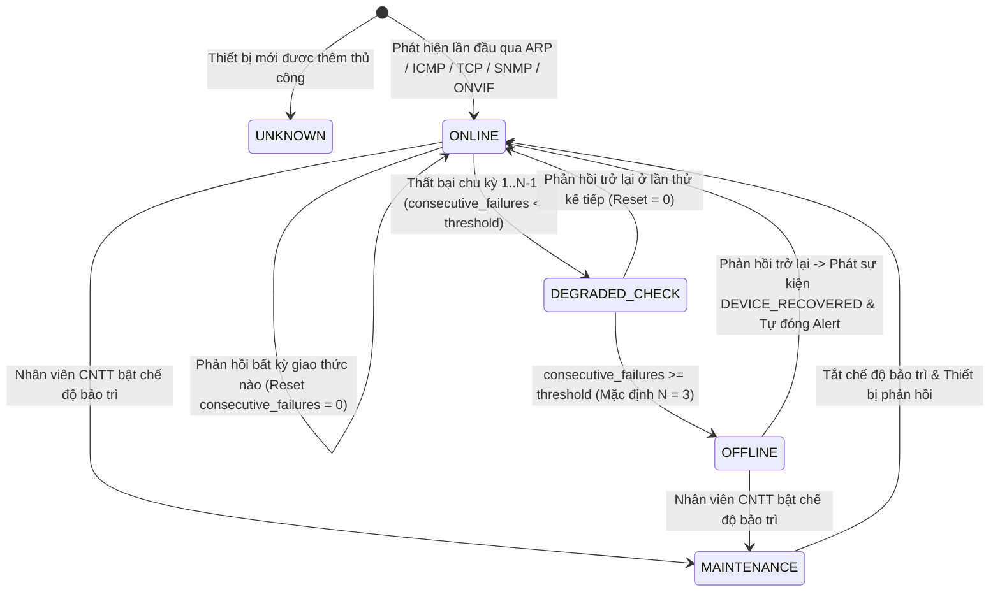

# 04. THIẾT KẾ SCANNER ENGINE (NETWORK SCANNER DESIGN)

Tài liệu này mô tả chi tiết kiến trúc kỹ thuật, thuật toán điều phối quét, quy tắc xét trạng thái Online/Offline, bộ thu thập đa giao thức (ARP, ICMP, TCP, DNS/NetBIOS, SNMP, ONVIF) và thuật toán định danh thiết bị (Device Fingerprinting) của **HICC V1.0 Scanner Engine**.

---

## 1. Kiến trúc Module của Scanner Engine

Scanner Engine (`scanner/hicc_scanner/`) được xây dựng bằng **Python 3.12+**, hoạt động độc lập hoàn toàn với giao diện người dùng (Frontend) và có thể khởi chạy theo 2 chế độ:
1. **Chế độ CLI độc lập (`Standalone CLI`):** Dành cho kỹ thuật viên CNTT kiểm thử trực tiếp trên từng Subnet hoặc IP cụ thể trên máy chủ Linux/Windows.
2. **Chế độ Dịch vụ Lập lịch (`Scheduled Daemon`):** Chạy nền với `APScheduler`, tự động đọc cấu hình chu kỳ từ PostgreSQL và thực thi các tác vụ giám sát định kỳ.

```mermaid
flowchart LR
    subgraph CLI_SCHED["Bộ Khởi Phát (Triggers)"]
        CLI["CLI Runner\n(hicc-scanner scan ...)"]
        CRON["APScheduler Daemon\n(30s / 5m / 15m / 30m)"]
    end

    subgraph CORE_PIPELINE["Luồng Xử Lý Lõi (Scanner Pipeline)"]
        SG["1. Subnet Guard\n(Kiểm tra CIDR & Quyền Quét)"]
        L2["2.1 ARP Discovery\n(Scapy L2 Ether/ARP)"]
        L3["2.2 ICMP Monitor\n(Async Multi-Ping + Retry)"]
        L4["2.3 Targeted TCP Probe\n(Async Socket / Nmap Service)"]
        DNS["2.4 Hostname Resolver\n(PTR, NetBIOS 137, mDNS)"]
        SNMP["2.5 SNMP Collector\n(PySNMP v3/v2c)"]
        ONVIF["2.6 ONVIF Probe\n(WS-Discovery UDP 3702 / HTTP)"]
        FP["2.7 Fingerprinting Engine\n(Chấm điểm & Phân loại)"]
    end

    subgraph OUTPUT["Đối Soát & Lưu Trữ"]
        RECON["Identity Reconciler\n(UUID Match + Two-Plane Merge)"]
        ALERT["Alert Engine\n(Dedup + State Transition)"]
        DB[("PostgreSQL 16")]
    end

    CLI --> SG
    CRON --> SG
    SG --> L2
    L2 --> L3
    L3 --> L4
    L4 --> DNS
    DNS --> SNMP
    DNS --> ONVIF
    SNMP --> FP
    ONVIF --> FP
    FP --> RECON
    RECON --> ALERT
    RECON --> DB
    ALERT --> DB
```

---

## 2. Cơ chế Kiểm soát Phạm vi An toàn (Subnet Guard)

Trước khi bất kỳ gói tin mạng nào được phát ra khỏi card mạng của máy chủ, module `SubnetGuard` thực hiện 4 bước kiểm tra bắt buộc:
1. **Kiểm tra RFC1918 (Private IP Enforcement):** Chỉ cho phép các dải mạng nội bộ chuẩn RFC1918 (`10.0.0.0/8`, `172.16.0.0/12`, `192.168.0.0/16`). Mọi địa chỉ IP Public hoặc Multicast/Loopback ngoài phạm vi đều bị chặn cứng ở tầng code (`SubnetSecurityError`).
2. **Kiểm tra Phê duyệt Database (`is_approved = TRUE`):** Đối chiếu CIDR mục tiêu với bảng `network_subnets`. Nếu Subnet chưa được Admin phê duyệt hoặc đang bị tạm khóa (`is_active = FALSE`), phiên quét bị từ chối ngay lập tức và ghi vào `audit_logs`.
3. **Giới hạn kích thước Subnet:** Không cho phép quét một lần vượt quá dải `/22` (1.022 hosts) trong một job đơn lẻ để tránh bão gói tin (Broadcast Storm). Các dải lớn hơn phải được chia theo đúng VLAN `/24` thực tế.
4. **Kiểm soát tốc độ (Rate Limiting):** Giới hạn số lượng gói tin đồng thời (`max_concurrency = 64` cho ICMP/ARP và `32` cho TCP/SNMP) nhằm đảm bảo tuyệt đối không gây nghẽn băng thông hoặc treo máy in mạng đời cũ.

---

## 3. Thiết kế Chi tiết 7 Module Quét Chuyên sâu

### 3.1. Module 2.1: ARP Discovery (`arp_scanner.py`)
- **Mục đích:** Phát hiện nhanh toàn bộ thiết bị đang hoạt động trong cùng miền quảng bá Lớp 2 (Same Broadcast Domain / Local VLAN) bất chấp tường lửa Windows chặn Ping.
- **Cơ chế hoạt động:**
  - Sử dụng `scapy` phát khung tin `Ether(dst="ff:ff:ff:ff:ff:ff")/ARP(pdst=subnet_cidr)` với timeout `1.5s` và `retry = 1`.
  - Thu thập cặp `(ip_address, mac_address)` phản hồi trực tiếp.
  - Tra cứu 3 byte đầu của địa chỉ MAC (24-bit OUI) với cơ sở dữ liệu **IEEE OUI Database nội bộ (Offline)** để xác định nhà sản xuất phần cứng (`mac_vendor`, ví dụ: `Hewlett Packard`, `Hangzhou Hikvision`, `Cisco Systems`, `Dell Inc.`).
- **Quy tắc L2/L3 nghiêm ngặt:**
  - Nếu Subnet có `scan_mode = 'ROUTED_L3'` (nằm khác VLAN với máy chủ Scanner, đi qua Router/L3 Switch), gói tin phản hồi ở L2 sẽ mang MAC của Default Gateway. Do đó, đối với `ROUTED_L3`, Scanner **tắt cơ chế gán MAC từ gói tin trực tiếp** để tránh gán nhầm MAC của Gateway cho hàng trăm thiết bị. Thay vào đó, MAC trên `ROUTED_L3` chỉ được thu thập nếu truy vấn được bảng `ipNetToMediaPhysAddress` (ARP Table) từ Core Switch/Gateway qua SNMP.
- **Phát hiện xung đột IP ở tầng ARP:** Nếu trong cùng một phiên quét ARP, một địa chỉ IP nhận được phản hồi từ `>= 2` địa chỉ MAC khác nhau, hệ thống lập tức đánh dấu sự kiện `IP_CONFLICT`.

### 3.2. Module 2.2: ICMP Monitoring (`icmp_scanner.py`)
- **Mục đích:** Kiểm tra trạng thái phản hồi Lớp 3, đo thời gian trễ (`latency_ms`) và tỷ lệ mất gói (`packet_loss`).
- **Cơ chế hoạt động:**
  - Gửi loạt 3 gói tin `ICMP Echo Request` (kích thước payload 32 bytes, cách nhau 200ms, timeout mỗi gói 1.000ms) tới từng IP mục tiêu theo cơ chế bất đồng bộ (`asyncio`).
  - Tính toán:
    - `latency_ms`: Trung bình cộng thời gian RTT của các gói thành công.
    - `packet_loss`: `(Số gói thất bại / 3) * 100%`.
  - Phân biệt rõ:
    - `ONLINE`: Có ít nhất 1/3 gói phản hồi (`ICMP Echo Reply`).
    - `TIMEOUT`: Cả 3 gói hết thời gian chờ (Chuyển tiếp sang kiểm tra ARP/TCP trước khi kết luận Offline).
    - `UNREACHABLE`: Nhận gói `ICMP Destination Host/Network Unreachable` từ Gateway.

### 3.3. Module 2.3: TCP Service Detection (`tcp_scanner.py`)
- **Mục đích:** Nhận diện thiết bị chặn ICMP Ping (như PC Windows bật Firewall) và thu thập dấu hiệu dịch vụ để phân loại thiết bị.
- **Nguyên tắc An toàn:** **Tuyệt đối không quét toàn bộ 65.535 cổng.** Chỉ kiểm tra có chọn lọc **14 cổng dịch vụ đặc trưng** với kết nối ngắn (`timeout = 1.2s`) và ngắt kết nối ngay sau khi xác nhận:

| Nhóm thiết bị mục tiêu | Các cổng TCP được kiểm tra | Ý nghĩa nhận diện kỹ thuật |
| :--- | :--- | :--- |
| **Máy tính / Laptop / Server** | `135` (MS-RPC), `139` (NetBIOS-SSN), `445` (SMB), `3389` (RDP), `22` (SSH) | Dấu hiệu đặc trưng của máy trạm Windows/Linux đang bật ngay cả khi chặn Ping. |
| **Máy in mạng (Network Printer)** | `9100` (HP JetDirect/RAW Print), `515` (LPD), `631` (IPP) | Dấu hiệu đặc trưng của máy in mạng chuyên dụng (HP, Canon, Brother, Ricoh). |
| **Camera IP / Đầu ghi NVR** | `554` (RTSP), `8000` (Hikvision SDK), `37777` (Dahua SDK), `8899` (ONVIF HTTP) | Dấu hiệu đặc trưng của thiết bị giám sát hình ảnh IP. |
| **Giao diện Quản trị Chung** | `80` (HTTP), `443` (HTTPS) | Giao diện quản trị Web của Switch, Máy in, Camera; thu thập nhẹ HTTP `Server` header & `<title>` trang đầu (không đăng nhập thử). |

### 3.4. Module 2.4: DNS / Hostname Discovery (`hostname_resolver.py`)
- **Mục đích:** Thu thập tên máy (`hostname`) thực tế phục vụ nhận diện nhanh máy tính của nhân viên hoặc thiết bị mạng.
- **Thứ tự ưu tiên thu thập (Fallback Chain):**
  1. **SNMP `sysName.0`** (Nếu thiết bị hỗ trợ SNMP — độ chính xác cao nhất cho Switch và Máy in).
  2. **Reverse DNS (`PTR Record`)** truy vấn tới DNS Server nội bộ của HEPCO.
  3. **NetBIOS Node Status Query (UDP Port 137)** — Cực kỳ hiệu quả để lấy Computer Name của máy tính Windows trong mạng LAN mà không cần Domain Controller hay Agent.
  4. **mDNS (UDP Port 5353)** — Hỗ trợ lấy tên máy in hiện đại và thiết bị macOS/Linux.
- **Nguyên tắc trung thực dữ liệu:** Nếu cả 4 phương thức trên không trả về kết quả, trường `discovered_hostname` được giữ là `NULL`. **Tuyệt đối không tự sinh tên giả** kiểu `Host-192-168-1-10` lưu vào trường hostname thực.

### 3.5. Module 2.5: SNMP Scanner (`snmp_scanner.py`)
- **Chính sách Bảo mật Giao thức:**
  - **Ưu tiên mặc định:** **SNMPv3** ở chế độ `authPriv` (Xác thực `SHA-256`/`SHA` + Mã hóa `AES-128`/`AES-256`).
  - **Chế độ tương thích:** **SNMPv2c** chỉ được kích hoạt trên các thiết bị đời cũ (như một số máy in mạng) khi bản ghi `device_credentials` tương ứng được Admin bật cờ `is_approved = TRUE`.
- **Các OID tiêu chuẩn được thu thập (Read-Only `GET` / `GETNEXT`):**
  - **MIB-II System (`1.3.6.1.2.1.1`):**
    - `sysDescr.0` (`1.3.6.1.2.1.1.1.0`): Mô tả phần cứng, hệ điều hành, phiên bản firmware.
    - `sysObjectID.0` (`1.3.6.1.2.1.1.2.0`): Mã định danh nhà sản xuất (Enterprise OID).
    - `sysUpTime.0` (`1.3.6.1.2.1.1.3.0`): Thời gian hoạt động liên tục từ lần khởi động gần nhất.
    - `sysName.0` (`1.3.6.1.2.1.1.5.0`) & `sysLocation.0` (`1.3.6.1.2.1.1.6.0`).
  - **IF-MIB (`1.3.6.1.2.1.2` & `1.3.6.1.2.1.31`):** Số lượng cổng (`ifNumber`), tên cổng (`ifName`), trạng thái vật lý/logic (`ifOperStatus`, `ifAdminStatus`), tốc độ cổng (`ifHighSpeed`).
  - **Printer-MIB (`1.3.6.1.2.1.43` — Chỉ áp dụng cho Máy in):**
    - `prtGeneralSerialNumber` (`1.3.6.1.2.1.43.5.1.1.17.1`): Số Serial máy in.
    - `prtMarkerLifeCount` (`1.3.6.1.2.1.43.10.2.1.4.1.1`): Tổng số trang đã in.
  - **LLDP-MIB (`1.0.8802.1.1.2`) & BRIDGE-MIB (`1.3.6.1.2.1.17`):** Thu thập bảng láng giềng LLDP và bảng MAC theo cổng Switch để phục vụ `device_relationships`.

### 3.6. Module 2.6: ONVIF Scanner (`onvif_scanner.py`)
- **Mục đích:** Phát hiện và kiểm tra sức khỏe các Camera IP / NVR trong mạng nội bộ.
- **Cơ chế hoạt động:**
  1. **Quảng bá tìm kiếm (WS-Discovery):** Gửi bản tin XML `Probe` chuẩn ONVIF (`dn:NetworkVideoTransmitter`) qua UDP Multicast `239.255.255.250:3702` trong Subnet nội bộ để nhận danh sách `XAddrs` và `Scopes` (chứa hãng sản xuất, model, vị trí nếu có).
  2. **Kiểm tra trực tiếp (Unicast Probe & Device Service):** Với các Camera đã biết IP hoặc nằm khác VLAN, kết nối tới cổng HTTP/ONVIF và gọi hàm `GetDeviceInformation` (nếu có thông tin xác thực Read-only được cấu hình trong `device_credentials`) để lấy `Manufacturer`, `Model`, `FirmwareVersion`, `SerialNumber`.
  3. **Kiểm tra dịch vụ RTSP:** Kiểm tra phản hồi `OPTIONS` trên cổng `554/TCP` để xác nhận tiến trình truyền hình ảnh của Camera vẫn hoạt động (không kéo luồng video).

### 3.7. Module 2.7: Device Fingerprinting & Confidence Scoring (`fingerprinter.py`)
Mọi thiết bị được phân loại dựa trên **Ma trận Trọng số Đa tín hiệu (Multi-Signal Weighted Scoring)** với thang điểm tin cậy từ `0` đến `100%`:

| Nguồn tín hiệu (Signal Source) | Trọng số tối đa | Dấu hiệu nhận diện cụ thể |
| :--- | :--- | :--- |
| **1. SNMP `sysObjectID` / `sysDescr` / Printer-MIB** | **+50 điểm** | Có phản hồi Printer-MIB -> `PRINTER`; `sysDescr` chứa `Cisco IOS / Huawei Versatile / Aruba / ProCurve / JetStream` -> `SWITCH`. |
| **2. ONVIF `NetworkVideoTransmitter` / Camera SDK Ports** | **+45 điểm** | Phản hồi WS-Discovery `NetworkVideoTransmitter` hoặc mở cổng `554` + (`8000` hoặc `37777`) -> `CAMERA`. |
| **3. Cổng dịch vụ TCP đặc thù (Targeted Ports)** | **+30 điểm** | Mở cổng `9100` hoặc `515` (không mở `445`) -> `PRINTER`; Mở `135` + `445` (SMB/RPC) -> `WORKSTATION` (hoặc `SERVER`). |
| **4. Địa chỉ MAC OUI Vendor** | **+20 điểm** | OUI thuộc `Hikvision`, `Dahua`, `Axis`, `Hanwha` -> Cộng điểm cho `CAMERA`; OUI thuộc `HP Inc`, `Canon`, `Brother`, `Ricoh`, `Epson` -> Cộng điểm cho `PRINTER`; OUI thuộc `Cisco`, `TP-Link`, `Ruijie`, `Juniper` -> Cộng điểm cho `SWITCH`. |
| **5. Mẫu Hostname / NetBIOS Name** | **+15 điểm** | Hostname dạng `DESKTOP-*`, `LAPTOP-*`, `PC-*` hoặc có cờ NetBIOS Workstation Service `<00>` -> `WORKSTATION`; dạng `NPI*`, `BRN*`, `CANON*` -> `PRINTER`. |

#### Quy tắc Ra quyết định Phân loại (Classification Threshold):
- **Điểm tổng hợp `>= 60`:** Gán `device_type` tương ứng có điểm cao nhất và lưu `confidence_score` thực tế (`60` – `100`).
- **Điểm tổng hợp `< 60` (Thiếu dữ liệu nhận diện):** Bắt buộc gán loại thiết bị là **`UNKNOWN` (Chưa xác định)** và lưu mức điểm hiện tại. **Tuyệt đối không tự đoán mò loại thiết bị khi chỉ có mỗi IP và Ping.**

---

## 4. Máy Trạng thái Online / Offline (State Machine)

Để giải quyết triệt để tình trạng báo động giả (False Offline) do rớt gói tin tức thời hoặc do tường lửa chặn Ping:

### Các Quy tắc Xét Trạng thái Bắt buộc:
1. **Kết hợp Đa giao thức (Multi-Probe Alive Check):** Một thiết bị được tính là **Đang hoạt động (`ONLINE`)** trong chu kỳ quét nếu thỏa mãn **ít nhất một** trong các điều kiện sau:
   - Phản hồi gói tin **ARP Reply** trực tiếp trong cùng Subnet L2.
   - Phản hồi gói tin **ICMP Echo Reply** (Ping).
   - Mở hoặc phản hồi gói tin `SYN-ACK` / `RST` từ bất kỳ cổng TCP đặc trưng nào trong danh sách kiểm tra.
   - Phản hồi truy vấn **SNMP** hoặc **ONVIF**.
2. **Xử lý Thiết bị Chặn ICMP (`icmp_blocked`):** Nếu thiết bị không phản hồi ICMP nhưng phản hồi ARP hoặc cổng TCP (ví dụ TCP 445/135 trên máy tính Windows), thiết bị vẫn được đánh dấu là **`ONLINE`** và bật cờ `icmp_blocked = TRUE` để giao diện hiển thị ghi chú kỹ thuật rõ ràng.
3. **Ngưỡng Thất bại Liên tiếp (`consecutive_failures`):**
   - Không bao giờ đánh dấu `OFFLINE` chỉ vì 1 lần Ping thất bại.
   - Mỗi chu kỳ kiểm tra thất bại trên tất cả các giao thức sẽ tăng biến đếm `consecutive_failures` lên `1`.
   - Chỉ khi `consecutive_failures >= default_offline_threshold` (mặc định là **3 chu kỳ liên tiếp**, có thể cấu hình riêng cho từng loại thiết bị), trạng thái mới chính thức chuyển từ `ONLINE` sang `OFFLINE` và kích hoạt cảnh báo `DEVICE_OFFLINE`.

---

## 5. Chu kỳ Lập lịch Quét Mặc định (Configurable Schedules)

Toàn bộ chu kỳ được lưu trong bảng `system_settings` và có thể điều chỉnh mà không cần sửa mã nguồn:

| Tác vụ (Job Type) | Chu kỳ mặc định | Khóa cấu hình (`system_settings.key`) | Mô tả kỹ thuật |
| :--- | :--- | :--- | :--- |
| **Kiểm tra Online/Offline** | `60 giây` (30–60s) | `scanner.status_check_interval_sec` | Quét nhanh ARP + ICMP + 2 cổng TCP chính của các thiết bị đã biết để cập nhật trạng thái và độ trễ. |
| **Discovery Thiết bị Mới** | `5 phút` (300s) | `scanner.discovery_interval_sec` | Quét toàn bộ dải IP trong các Subnet được duyệt để phát hiện thiết bị mới xuất hiện hoặc đổi IP. |
| **SNMP Monitoring** | `5 phút` (300s) | `scanner.snmp_poll_interval_sec` | Thu thập thông số Switch (trạng thái cổng, uptime) và Máy in (trạng thái, bộ đếm trang in). |
| **Full Discovery Scan** | `15 phút` (900s) | `scanner.full_scan_interval_sec` | Quét kết hợp đầy đủ TCP 14 cổng, ONVIF Probe và chạy lại bộ phân loại Fingerprinting cho các thiết bị `UNKNOWN`. |
| **Làm mới Hostname** | `30 phút` (1800s) | `scanner.hostname_refresh_interval_sec` | Truy vấn lại Reverse DNS, NetBIOS (UDP 137) và mDNS để cập nhật tên máy tính mới nhất. |
