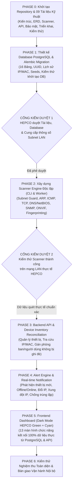

# 09. LỘ TRÌNH PHÁT TRIỂN VÀ MỞ RỘNG (DEVELOPMENT ROADMAP)

Tài liệu này hoạch định lộ trình triển khai từng giai đoạn của dự án **HEPCO IT COMMAND CENTER (HICC V1.0)** theo đúng nguyên tắc **"Lõi kỹ thuật và dữ liệu thực tế đi trước, giao diện đi sau"**, đồng thời định hướng mở rộng cho các phiên bản tương lai.

---

## 1. Sơ đồ Lộ trình Triển khai Bắt buộc (HICC V1.0 Stage-Gated Roadmap)

---

## 2. Chi tiết Sản phẩm Bàn giao theo Từng Chặng (Deliverables Matrix)

| Chặng | Hạng mục công việc trọng tâm | Sản phẩm bàn giao (Deliverables) | Điều kiện hoàn thành (Exit Criteria) |
| :--- | :--- | :--- | :--- |
| **PHASE 0** | Khởi tạo cấu trúc dự án chuẩn và bộ tài liệu kiến trúc kỹ thuật tiếng Việt. | - Cấu trúc thư mục `HEPCO-IT-COMMAND-CENTER/` - Đầy đủ 09 tài liệu trong `docs/` - `docker-compose.yml`, `.env.example`, `README.md` | Tài liệu chi tiết, rõ ràng, có đầy đủ sơ đồ kiến trúc và ERD để đội ngũ kỹ thuật đối chiếu. |
| **PHASE 1** | Thiết kế lược đồ PostgreSQL, SQLAlchemy Models, Alembic Migration và kịch bản Seed. | - `backend/app/models/` (16 bảng) - `database/migrations/` (Alembic) - `database/seeds/initial_seed.py` - Bài test khởi tạo DB | Chạy `alembic upgrade head` khởi tạo sạch toàn bộ 16 bảng, khóa ngoại, index và seed thành công từ đầu. |
| **PHASE 2** | Phát triển Scanner Engine độc lập chạy qua CLI và dịch vụ lập lịch APScheduler. | - `scanner/hicc_scanner/` (7 module quét) - Công cụ CLI `hicc-scanner` - Cơ sở dữ liệu OUI nội bộ | Quét thử nghiệm thành công trên Subnet được duyệt của HEPCO; nhận diện đúng IP, MAC, Hostname, loại thiết bị. |
| **PHASE 3** | Xây dựng hệ thống API Quản lý Thiết bị (Device Inventory) & Tra cứu IP/MAC. | - REST API `/api/v1/devices`, `/api/v1/lookup`, `/api/v1/subnets` - Logic tách biệt dữ liệu tự động và thủ công | Nhân viên CNTT gán phòng ban/người dùng/vị trí không bị mất dữ liệu sau các chu kỳ quét tiếp theo. |
| **PHASE 4** | Xây dựng Bộ máy Cảnh báo (Alert Engine) và nhật ký sự kiện mạng. | - Module đánh giá quy tắc cảnh báo - Chống trùng lặp bằng `dedup_key` - API tiếp nhận & xử lý cảnh báo | Phát hiện chính xác thiết bị mới, mất kết nối, khôi phục, đổi IP, xung đột IP mà không sinh cảnh báo rác. |
| **PHASE 5** | Xây dựng Giao diện Điều hành (Dashboard & 13 phân mục Sidebar). | - Ứng dụng React + TypeScript + Tailwind + shadcn/ui + Recharts - Kết nối REST API & WebSocket | Giao diện Dark Mode chuẩn tông màu HEPCO, hiển thị 100% dữ liệu thực từ PostgreSQL, phản hồi < 2 giây. |

---

## 3. Danh sách Thông tin Bộ phận CNTT HEPCO Cần Cung cấp Trước Khi Chạy PHASE 2

Để cấu hình Scanner Engine sát với thực tế hạ tầng của HEPCO và tuyệt đối không quét nhầm dải mạng:

1. **Danh sách Dải mạng (Subnet CIDR) & VLAN cần giám sát:**
   - Ví dụ: VLAN Văn phòng chính (`192.168.x.0/24`), VLAN Máy chủ/Thiết bị mạng, VLAN Camera an ninh, VLAN Trạm cân/Trạm thu phí...
   - Xác định rõ dải mạng nào sẽ được dùng làm **Subnet Kiểm thử Đầu tiên (Pilot Subnet)** cho Phase 2.
2. **Vị trí đặt Máy chủ HICC (Network Placement):**
   - Địa chỉ IP tĩnh dự kiến cấp cho máy chủ HICC.
   - Máy chủ HICC nằm cùng VLAN với các thiết bị hay đi qua bộ định tuyến L3 Switch / Firewall?
3. **Thông tin Máy chủ DNS Nội bộ (Nếu có):**
   - Địa chỉ IP của Internal DNS Server / Active Directory Domain Controller (nếu HEPCO có sử dụng) để cấu hình Reverse DNS chuẩn xác.
4. **Thông số SNMP và Danh sách Switch / Máy in tiêu biểu:**
   - Các dòng Switch quản trị đang sử dụng tại HEPCO (ví dụ: Cisco, TP-Link JetStream, Aruba, Ruijie...) và phiên bản SNMP đang bật (`SNMPv3` hay `SNMPv2c`).
   - Các dòng Máy in mạng chính (ví dụ: HP LaserJet, Canon LBP/iR, Brother, Ricoh...).
5. **Thông tin chủng loại Camera IP / Đầu ghi NVR:**
   - Hãng sản xuất phổ biến tại đơn vị (ví dụ: Hikvision, Dahua, KBVision, Axis...) và tình trạng bật giao thức ONVIF.

---

## 4. Định hướng Mở rộng trong Tương lai (Post-V1.0 Vision: V1.5 & V2.0)

Kiến trúc của HICC V1.0 đã được thiết kế mở để sẵn sàng nâng cấp lên các phiên bản tiếp theo khi HEPCO có nhu cầu:
- **Phiên bản V1.5 (Quản trị Chuyên sâu & Thông báo Đa kênh):**
  - Tích hợp gửi cảnh báo khẩn cấp (Switch sập, Xung đột IP, Máy chủ mất kết nối) qua **Zalo OA / Telegram Bot nội bộ / Email SMTP**.
  - Thu thập bảng MAC Forwarding Database (`dot1dTpFdbTable`) từ tất cả các Switch nhánh để tự động xác định chính xác một máy tính hoặc camera đang cắm ở **Port vật lý số mấy** trên Switch nào.
- **Phiên bản V2.0 (Optional Lightweight Agent & Đồng bộ ERP):**
  - Cung cấp tùy chọn cài đặt **HICC Lightweight Agent** (tùy chọn cho máy trạm Windows quan trọng) để thu thập sâu cấu hình CPU, RAM, dung lượng ổ cứng, tình trạng sức khỏe SSD SMART, bản vá bảo mật Windows và danh sách phần mềm.
  - Đồng bộ hai chiều mã tài sản (`device_code`) và lịch sử bảo trì/sửa chữa với phân hệ Quản lý Tài sản / Phần mềm nội bộ hiện hành của HEPCO.
